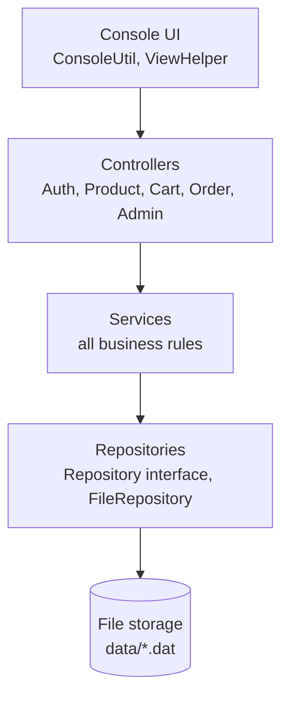
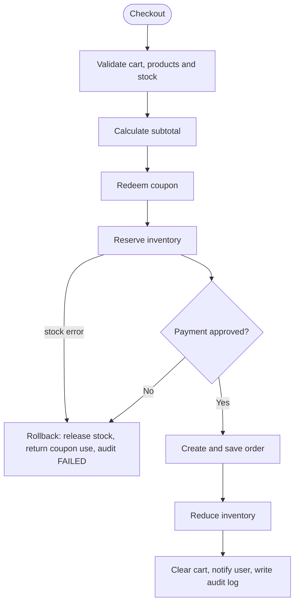

<div align="center">

# 🛒 ShopCore

### A layered e-commerce backend built with **pure Core Java**
*No Spring. No database. No external libraries. Just the JDK.*


</div>

---

## 📑 Table of Contents

- [About](#-about)
- [Features](#-features)
- [Architecture](#-architecture)
- [Quick Start](#-quick-start)
- [How to Use](#-how-to-use)
- [Sample Session](#-sample-session)
- [How an Order Is Processed](#-how-an-order-is-processed)
- [Concurrency Stress Test](#-concurrency-stress-test)
- [Project Structure](#-project-structure)
- [Data Storage](#-data-storage)
- [Configuration](#-configuration)
- [Security](#-security)
- [Design Patterns and Java Concepts](#-design-patterns-and-java-concepts)
- [Limitations and Roadmap](#-limitations-and-roadmap)
- [Troubleshooting](#-troubleshooting)
- [License](#-license)
- [Author](#-author)

---

## 📖 About

**ShopCore** is a console-based e-commerce backend that models how a real online store works behind the scenes:
customers register, search a catalogue, fill a cart, apply coupons, pay, and cancel orders, while admins manage
products, stock, users, coupons, orders, reports and audit logs.

It is written **entirely with the Java standard library**. Every piece that a framework would normally hide
(dependency injection, persistence, password hashing, validation, logging, thread safety) is implemented by hand,
which makes the project a compact reference for **clean layered design in plain Java**.

| | |
|---|---|
| **Language** | Java 11+ (developed and tested on JDK 21) |
| **Size** | about 80 source files, roughly 3,400 lines |
| **Storage** | Java object serialization in a local `data/` folder |
| **Interface** | Interactive console menus |
| **Roles** | `USER` (customer) and `ADMIN` |

---

## ✨ Features

### 👤 Customers
- 🔐 **Register and login** with validated input and salted password hashing
- 🛍️ **Browse** all products or by category, and open a product page
- 🔎 **Search and filter**: keyword, category, brand, price range, minimum rating, in-stock only
- ↕️ **Sort** by relevance, price (low to high or high to low), rating, or newest
- 🧺 **Cart**: add, change quantity, remove, clear, with stock checks and a "price changed" warning
- 💝 **Wishlist**: save products and move them to the cart
- 🎟️ **Coupons**: percentage or flat discounts with minimum order, maximum discount, expiry and usage limits
- 💳 **Checkout** with UPI, Card, Net Banking or Cash on Delivery (simulated)
- 📦 **Order history**, order details and **cancellation** with automatic stock restore and refund
- 👤 **Profile**: update details and change password

### 🛠️ Admins
- 📦 **Products**: add, update, soft-delete
- 🏬 **Inventory**: view stock, low-stock alerts, add stock, set exact stock
- 👥 **Users**: list, block, unblock, create another admin
- 🧾 **Orders**: view all, update status (PLACED → CONFIRMED → SHIPPED → DELIVERED), cancel
- 🎫 **Coupons**: create, list, deactivate
- 📊 **Reports**: revenue, average order value, orders by status, top sellers, revenue by category, low stock
- 📜 **Audit logs**: last 20 or 50 events, or all events of one user

### ⚙️ Under the hood
- 🔒 **Thread-safe inventory** with one lock per product and a reserve → pay → commit flow with rollback
- 🧾 **Audit trail** of every important action (logins, cart changes, payments, orders, admin changes)
- 🔔 **Notifications** through the Observer pattern (console and file)
- 💾 **Crash-safe persistence** (data is written to a temp file, then swapped in)
- 🌱 **Sample data** seeded on first run (12 products, 3 coupons)

---

## 🏗️ Architecture

ShopCore follows a strict layered design. **A layer only talks to the layer directly below it.**



| Layer | Responsibility | Never does |
|---|---|---|
| **Controllers** | Show menus, read input, print results, handle errors | Contain business rules |
| **Services** | Stock, coupons, payments, order flow, validation | Read the keyboard or touch files |
| **Repositories** | Save and load objects | Contain business rules |

**Why it matters:** replacing the console with a REST API only changes the controllers, and replacing files with a
database only changes the repositories. The services stay the same.

Cross-cutting packages: `exception` (error types), `security` (password hashing, session), `logging` (audit and
application logs), `util` (helpers), `config` (settings and dependency wiring).

---

## 🚀 Quick Start

### Prerequisites
- **JDK 11 or newer** (check with `java -version` and `javac -version`)
- Optional: IntelliJ IDEA or Eclipse

### 1. Get the code
```bash
git clone https://github.com/Rishabhraj2003/shopcore.git
cd shopcore
```

### 2. Build and run

| | Windows | Linux / macOS |
|---|---|---|
| **Compile** | `build.bat` | `./build.sh` |
| **Run the app** | `run.bat` | `./run.sh` |
| **Run the stress test** | `demo.bat` | `./demo.sh` |

Or run it manually:
```bash
mkdir out
javac -encoding UTF-8 -d out $(find src -name '*.java')
java -Dfile.encoding=UTF-8 -cp out com.shopcore.Main
```

### 3. Run from IntelliJ IDEA
1. **File → New → Project from Existing Sources**, select the `shopcore` folder, and choose JDK 11+.
2. Make sure `src` is marked as **Sources Root**.
3. Set **File → Settings → Editor → File Encodings** to **UTF-8**.
4. Open `src/com/shopcore/Main.java` and click the green ▶ next to `main`.
5. Click inside the **Run** window to type your input.

### 4. First-run setup
The first time the app starts it:
1. Creates the `data/` folder and loads **12 sample products** and **3 sample coupons**.
2. Asks you to **create the admin account** (name, email, password). No admin password exists in the source code.

> 💡 For unattended setups you can set `SHOPCORE_ADMIN_EMAIL` and `SHOPCORE_ADMIN_PASSWORD` as environment
> variables before the first run instead of answering the prompts.

To reset everything, stop the app and delete the `data/` folder.

---

## 🧭 How to Use

### Customer menu
```
1. Products    4. Wishlist
2. Search      5. Orders
3. Cart        6. Profile      7. Logout
```

**Typical journey:** Register → Login → Products or Search → open a product → Add to cart → Cart → Proceed to
checkout → enter a coupon, address and payment method → confirm → view the order under **Orders**.

### Admin menu
```
1. Manage Products    5. Manage Coupons
2. Manage Inventory   6. Reports
3. Manage Users       7. Audit Logs
4. Manage Orders      8. Logout
```

### Sample coupons

| Code | Discount | Minimum order | Cap | Usage limit |
|---|---|---|---|---|
| `WELCOME10` | 10% off | ₹500 | ₹300 | 1,000 |
| `FLAT200` | ₹200 off | ₹1,500 | none | 500 |
| `BIGSAVE` | 15% off | ₹10,000 | ₹5,000 | 100 |

Sample coupons expire one year after the first run.

### Business rules at a glance

| Rule | Value |
|---|---|
| Tax | 18% on the discounted amount |
| Max quantity per product per cart | 10 |
| Low-stock threshold | 5 units |
| Password | at least 8 characters, with a letter and a digit |
| Phone | valid 10-digit Indian mobile number |
| Cancellation allowed | only while the order is `PLACED` or `CONFIRMED` |
| Payment limits (simulated) | UPI ₹1,00,000 · Card ₹5,00,000 · Net Banking ₹10,00,000 · COD ₹50,000 |
| COD payment | stays `PENDING` until the order is `DELIVERED` |

---

## 🖥️ Sample Session

Shortened output from a real run: checking out two headphones with the `WELCOME10` coupon (typed input shown inline):

```text
========== YOUR CART ==========
ID       Name                           Qty   Unit price    Line total
----------------------------------------------------------------------------------------------------
P1001    boAt Rockerz 450 Headphones      2    ₹1,199.20     ₹2,398.40
----------------------------------------------------------------------------------------------------
Cart total: ₹2,398.40
Coupon code (Enter to skip): WELCOME10
[OK] Coupon accepted. You save about ₹239.84
Payment method:
  1. UPI
  2. CARD
  3. NET_BANKING
  4. COD
[NOTIFICATION to U1001] Order ORD1001 placed successfully. Total ₹2,547.10
[OK] Order placed!

========== ORDER ORD1001 ==========
Order status  : PLACED
Payment status: SUCCESS
Ship to       : 12 MG Road, Noida
----------------------------------------------------------------------------------------------------
Subtotal                       ₹2,398.40
Discount (WELCOME10)           -₹239.84
Tax (18%)                      ₹388.54
TOTAL                          ₹2,547.10
```

A declined payment is reported clearly and leaves no stock reserved:

```text
[ERROR] COD payment of ₹53,148.97 was declined (amount exceeds the COD limit). Try another payment method.
```

Every action also lands in the audit log:

```text
2026-10-06 01:21:08 | USER: U1001 | ACTION: ORDER_PLACED | REF: ORD1001 | AMOUNT: ₹2,547.10 | STATUS: SUCCESS
2026-10-06 01:21:08 | USER: U1001 | ACTION: PAYMENT_REFUNDED | REF: ORD1001 | AMOUNT: ₹2,547.10 | STATUS: REFUNDED
2026-10-06 01:21:08 | USER: U1001 | ACTION: ORDER_CANCELLED | REF: ORD1001 | AMOUNT: ₹2,547.10 | STATUS: SUCCESS
```

---

## 🔄 How an Order Is Processed



- **Reserve before paying:** another buyer cannot take the last item while the payment is processing.
- **Compensation on failure:** if anything fails after stock is reserved or a coupon is used, those steps are undone.
- **Cancellation** restores stock, refunds the payment (or cancels a pending COD payment) and returns the coupon use.
- **Order items are snapshots:** later price or name changes never alter old orders.

---

## 🧵 Concurrency Stress Test

`ConcurrencyDemo` starts **50 buyer threads** that all try to buy a product with only **10 units** in stock at the same
moment. It runs in a temporary folder, so your real data is never touched.

```bash
./demo.sh        # Windows: demo.bat
```

Expected output:

```text
Successful orders : 10
Out-of-stock      : 40
Other errors      : 0
Final stock       : available=0, reserved=0
Orders saved      : 10

RESULT: PASS - no overselling.
```

How it works: `InventoryService` holds **one lock per product**, so the "check stock, then reserve it" step is a single
atomic action for that product, while buyers of different products never wait for each other. Stores use
`ConcurrentHashMap`, file writes are synchronized, and coupon redemption is atomic.

> ⚠️ A stress test shows that no overselling was *observed*. It cannot prove the absence of race conditions. The
> per-product lock is what guarantees correctness.

---

## 🗂️ Project Structure

```text
shopcore/
├── src/com/shopcore/
│   ├── Main.java                 # entry point, main loop, first-run admin setup
│   ├── config/                   # AppConfig, AppContext (wiring), DataSeeder
│   ├── controller/               # Auth, Product, Cart, Order, Admin controllers + ViewHelper
│   ├── service/                  # Auth, User, Product, Search, Cart, Wishlist, Coupon,
│   │                             # Inventory, Payment, Order, Admin, Notification services
│   ├── repository/               # Repository interface, generic FileRepository + one per entity
│   ├── model/                    # User, Product, Cart, CartItem, Wishlist, Coupon,
│   │                             # Order, OrderItem, Payment, Inventory
│   ├── enums/                    # Role, UserStatus, OrderStatus, PaymentStatus, PaymentMethod,
│   │                             # DiscountType, Category, AuditAction
│   ├── exception/                # ShopCoreException and 7 specific exceptions
│   ├── security/                 # PasswordManager (PBKDF2), SessionManager
│   ├── strategy/                 # DiscountStrategy: percentage and flat
│   ├── payment/                  # PaymentProcessor: UPI, Card, Net Banking, COD
│   ├── factory/                  # PaymentFactory
│   ├── notification/             # Observer: console and file notifications
│   ├── logging/                  # AuditLogger (business), AppLogger (technical)
│   ├── util/                     # ConsoleUtil, InputValidator, IdGenerator, DateUtil, MoneyUtil
│   └── demo/                     # ConcurrencyDemo
├── build.sh / build.bat          # compile
├── run.sh   / run.bat            # run the app
├── demo.sh  / demo.bat           # run the concurrency stress test
├── LICENSE
└── README.md
```

---

## 💾 Data Storage

All data lives in a **`data/`** folder created in the working directory (the project root when run from an IDE).
The folder is excluded from Git by `.gitignore`.

| File | Contents |
|---|---|
| `users.dat`, `products.dat`, `orders.dat`, `carts.dat`, `wishlists.dat`, `coupons.dat`, `inventory.dat`, `payments.dat` | One binary file per entity (Java serialization) |
| `counters.properties` | Next ID numbers (`U1001`, `P1002`, `ORD1003`, ...) |
| `audit.log` | Business audit trail (readable text) |
| `notifications.log` | Every notification sent (readable text) |
| `shopcore.log` | Technical errors and warnings |

IDs are readable: users `U1001`, admins `A1001`, products `P1001`, orders `ORD1001`.

---

## ⚙️ Configuration

Tunable values live in one file: [`config/AppConfig.java`](src/com/shopcore/config/AppConfig.java).

| Setting | Default | Meaning |
|---|---|---|
| `TAX_RATE` | `0.18` | Tax applied after discounts |
| `LOW_STOCK_THRESHOLD` | `5` | Items at or below this appear in low-stock lists |
| `MAX_QTY_PER_ITEM` | `10` | Per-product quantity limit in a cart |
| `UPI_LIMIT`, `CARD_LIMIT`, `NET_BANKING_LIMIT`, `COD_LIMIT` | see above | Simulated payment limits |
| `CURRENCY_SYMBOL` | `₹` | Change to `"Rs."` if your console cannot show ₹ |

Environment variables (first run only): `SHOPCORE_ADMIN_EMAIL`, `SHOPCORE_ADMIN_PASSWORD`.

---

## 🔐 Security

- **Password hashing:** PBKDF2-HMAC-SHA256, 65,536 iterations, random 16-byte salt per user. Passwords are never stored or logged in plain text.
- **Constant-time comparison** when verifying passwords.
- **Non-revealing login errors:** "Invalid email or password" for both unknown email and wrong password.
- **No credentials in source code:** the admin account is created by the owner on first run.
- **Role checks:** the admin panel re-verifies the ADMIN role every time it is shown; users can only cancel or view their own orders.
- **Blocked accounts** cannot log in.
- **Audit logging** of logins (including failures), payments and all admin actions.

---

## 🧩 Design Patterns and Java Concepts

| Pattern | Where | Purpose |
|---|---|---|
| **Layered architecture** | whole project | Separation of concerns |
| **Repository** | `Repository`, `FileRepository` | Storage hidden from services |
| **Strategy** | `DiscountStrategy` | New discount types without changing existing code |
| **Factory** | `PaymentFactory` | Choose a payment processor by method |
| **Observer** | `NotificationService` + observers | Add notification channels without touching order code |
| **Singleton** | `SessionManager`, `AuditLogger` | One session, one log writer |
| **Fluent builder** | `SearchCriteria` | Many optional filters, readable calls |
| **Dependency injection (manual)** | `AppContext`, constructors | Loose coupling, testable services |

**Java concepts demonstrated:** OOP and polymorphism, generics, collections (`ConcurrentHashMap`, `EnumMap`, `LinkedHashMap`),
Streams and lambdas (search, reports), `Optional`, custom exception hierarchy, file I/O and serialization,
`synchronized` and per-key locks, `ExecutorService`, `CountDownLatch`, `AtomicInteger`, enums with behaviour,
`java.time`, `java.util.logging`, regex validation.

---

## 🚧 Limitations and Roadmap

**Known limitations**
- Money uses `double` with rounding. Production systems should use `BigDecimal`.
- Java serialization ties data files to the class definitions; after changing a model class, delete `data/`.
- The whole file is rewritten on every save, which suits small data sets only.
- Locks work within one JVM; running two instances on the same files is not supported.
- Payments are simulated; there is no real gateway.
- No automated unit tests yet (the concurrency demo is the one executable check).

**Roadmap**
- [ ] JUnit tests for coupon, order and search logic
- [ ] Migrate money fields to `BigDecimal`
- [ ] Admin: delete user (soft delete) and change own password
- [ ] REST layer using the JDK's built-in `HttpServer`
- [ ] JDBC repositories behind the existing `Repository` interface
- [ ] Product reviews that compute ratings

---

## 🩺 Troubleshooting

| Problem | Fix |
|---|---|
| `₹` shows as `?` | Run `chcp 65001` (Windows) and use `-Dfile.encoding=UTF-8`, or set `CURRENCY_SYMBOL` to `"Rs."` |
| `Project SDK is not defined` (IntelliJ) | **File → Project Structure → Project**, choose JDK 11+ |
| Red imports in IntelliJ | Right-click `src` → **Mark Directory as → Sources Root** |
| Input does nothing in the IDE | Click inside the Run window before typing |
| `Could not load ... .dat` | A model class changed; delete the `data/` folder |
| Want a clean start | Stop the app and delete the `data/` folder |
| Password is visible while typing | Normal in IDE consoles; a real terminal hides it |

---

## 📄 License

Released under the **MIT License**. See [`LICENSE`](LICENSE) for details.

---

## 👨‍💻 Author

**Rishabh Raj**, final-year B.Tech Computer Science student.

[](https://github.com/Rishabhraj2003)
[](https://www.linkedin.com/in/rishabh-raj-54424b305)
[](https://rishabhraj2003.github.io/portfolios)

<div align="center">

⭐ If you found this project useful, consider giving it a star.

</div>
